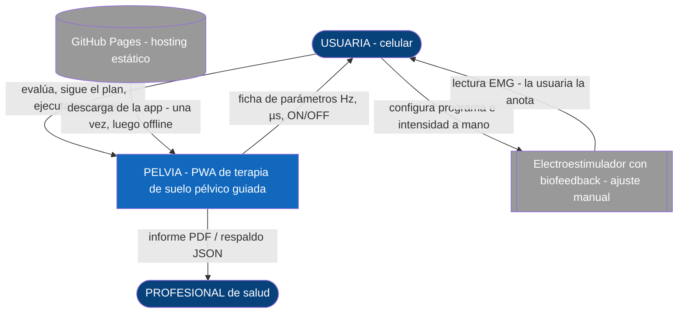
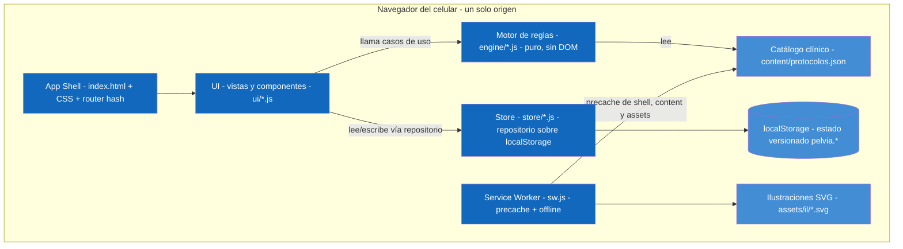
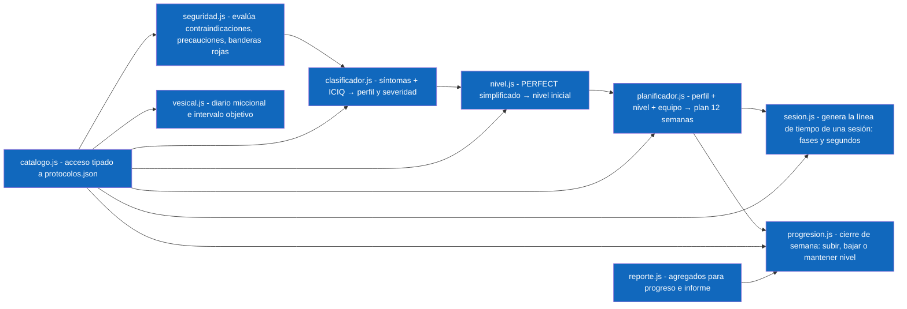
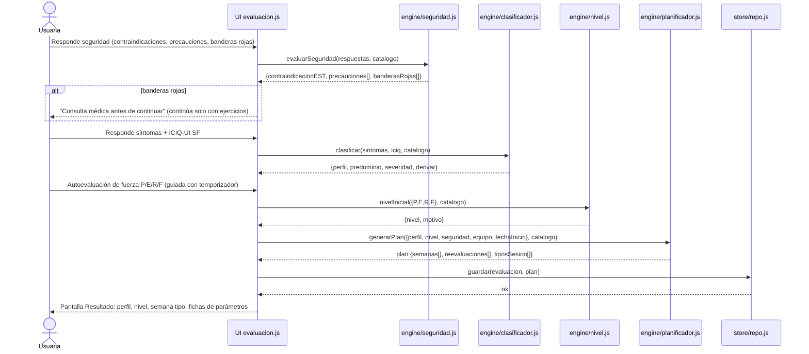
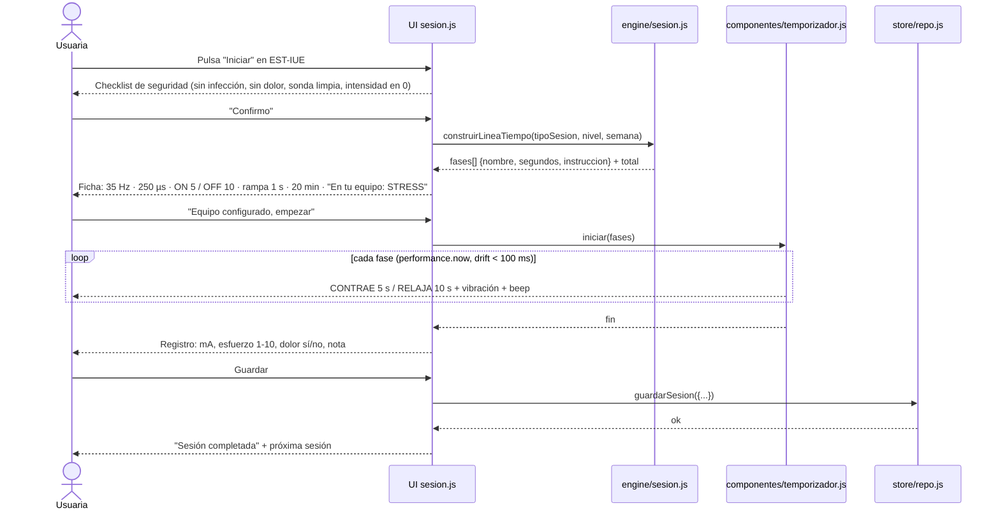
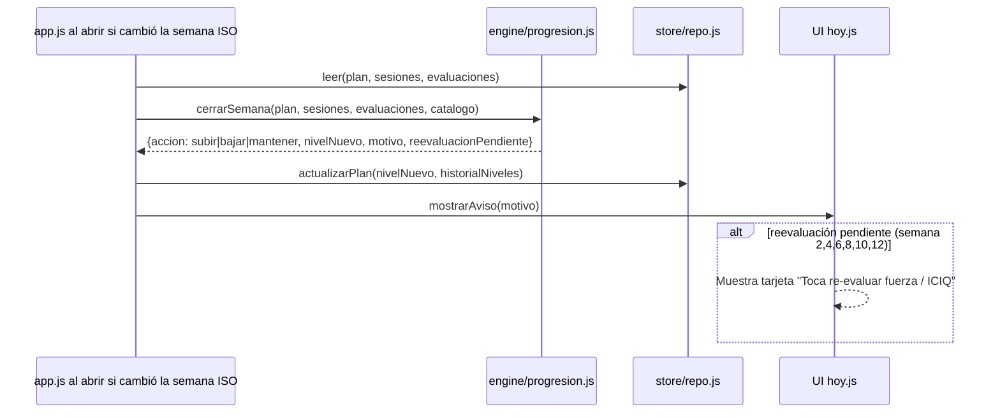
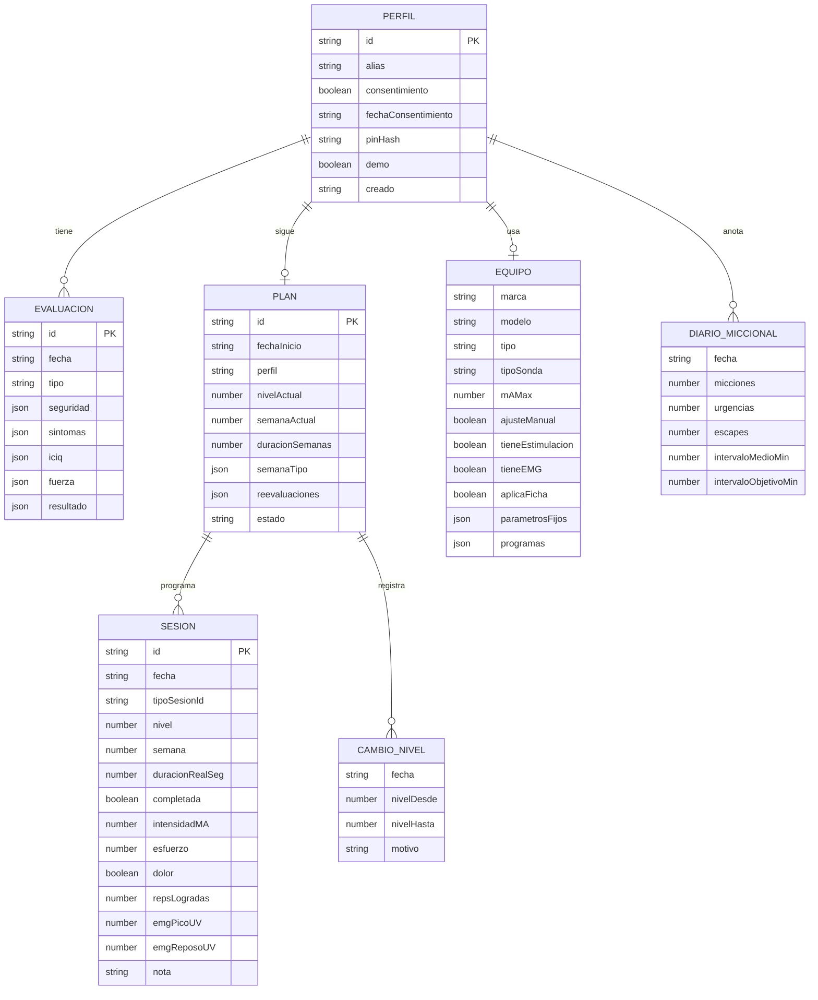
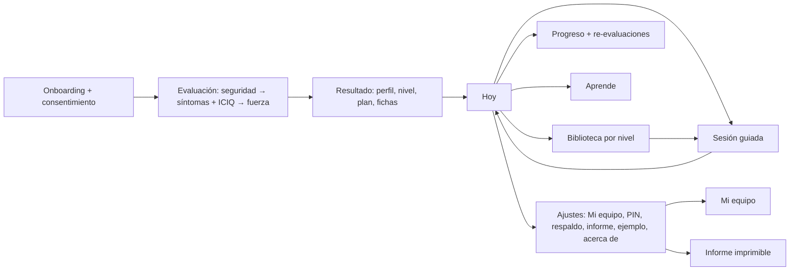

# Diseño — PELVIA
Versión: 0.1 · Fecha: 2026-11-03 · Fase 2 del ciclo (ingeniería profesional) · Depende de `docs/spec.md` v0.1

Decisiones grandes registradas en `docs/adr/`:
ADR-0001 PWA vanilla sin build · ADR-0002 Equipo agnóstico (solo guía) · ADR-0003 Datos locales y privacidad ·
ADR-0004 Motor de reglas declarativo · ADR-0005 Contenido clínico como datos · ADR-0006 Ilustraciones SVG originales.

---

## 1. Visión de arquitectura en una frase
Una PWA de un solo origen, sin servidor, cuyo núcleo es un **motor de reglas puro** (`engine/`) que lee el **catálogo clínico**
(`content/protocolos.json`) y produce perfil → nivel → plan → sesiones; la UI (`ui/`) solo renderiza y captura, y el estado vive en
`localStorage` detrás de un **repositorio** (`store/`) con esquema versionado.

## 2. Modelo C4

### 2.1 Nivel 1 — Contexto


### 2.2 Nivel 2 — Contenedores


### 2.3 Nivel 3 — Componentes del motor (`engine/`)

Regla de dependencia: `engine/` **no importa nada de `ui/` ni de `store/`**; recibe datos planos y devuelve datos planos.
Así se prueba con `node --test` sin navegador (RNF-09).

## 3. Estructura del repositorio
```
pelvia-app/
├── index.html                 # App shell: layout, nav inferior, <main id="vista">
├── manifest.webmanifest       # nombre, iconos, display standalone, theme_color
├── sw.js                      # precache (lista explícita) + estrategia cache-first
├── css/
│   ├── tokens.css             # variables de color, tipografía, espaciado (§8)
│   └── app.css                # layout, componentes, sesión (temporizador grande)
├── js/
│   ├── app.js                 # bootstrap: carga catálogo, migra store, router
│   ├── router.js              # rutas #/hoy #/evaluacion #/sesion/:id #/biblioteca ...
│   ├── engine/                # motor puro (ver §2.3)
│   ├── store/
│   │   ├── repo.js            # get/set por clave, migraciones por versión de esquema
│   │   └── respaldo.js        # exportar/importar JSON, validación
│   ├── ui/
│   │   ├── vistas/            # hoy.js evaluacion.js resultado.js sesion.js biblioteca.js
│   │   │                      # progreso.js equipo.js aprende.js ajustes.js acerca.js informe.js
│   │   └── componentes/       # temporizador.js grafica-svg.js tarjeta-sesion.js ficha-parametros.js
│   │                          # checklist-seguridad.js modal.js pin.js
│   └── util/                  # fechas.js (semanas ISO), audio.js (beep WebAudio), vibrar.js, wakelock.js
├── content/
│   └── protocolos.json        # catálogo clínico (ADR-0005)
├── assets/
│   ├── il/                    # ilustraciones SVG originales IL-01..IL-14 (§9)
│   ├── icons/                 # iconos PWA 192/512, logo-kolh.png
│   └── sonidos/               # (opcional) beep.wav si no se usa WebAudio
├── tests/                     # node --test  → engine/*.test.js, store/*.test.js
├── docs/                      # spec, diseño, adr/, plan-pruebas, manual-usuario, manual-tecnico, runbook
└── README.md
```

## 4. Diagramas de secuencia

### 4.1 Evaluación inicial → perfil → nivel → plan (RF-02..RF-07)


### 4.2 Sesión guiada de electroestimulación (RF-07, RF-08, RF-21)


### 4.3 Cierre de semana → progresión de nivel (RF-11, RF-14)


### 4.4 Respaldo e informe (RF-18)
```mermaid
sequenceDiagram
    actor U as Usuaria
    participant V as UI ajustes.js / informe.js
    participant B as store/respaldo.js
    participant RP as engine/reporte.js
    U->>V: "Exportar respaldo"
    V->>B: exportar()
    B-->>U: descarga pelvia-respaldo-AAAA-MM-DD.json
    U->>V: "Importar"
    V->>B: importar(archivo)
    B->>B: validar esquema y versión; migrar si es anterior
    B-->>V: ok | error con motivo
    U->>V: "Informe para mi profesional"
    V->>RP: agregar(evaluaciones, sesiones, plan)
    RP-->>V: resumen + series para gráficas
    V-->>U: vista imprimible (window.print → PDF)
```

## 5. Modelo de datos (estado local)
Clave raíz en `localStorage`: `pelvia.<entidad>`; `pelvia.meta` guarda `{esquema: 1, app: "0.1.0"}` para migraciones.

Reglas del store: escritura atómica por clave (`JSON.stringify` completo); `migrar(esquemaViejo → nuevo)` en `app.js`;
el respaldo exporta todas las claves `pelvia.*` más `meta`; la importación rechaza archivos sin `meta.esquema`.

## 6. Motor de reglas (tablas de decisión)

### 6.1 Seguridad (`seguridad.js`) — fuente: POGP 2021 + manuales de fabricantes
| Tipo | Ítems (resumen; texto completo en `protocolos.json → seguridad`) | Efecto |
|---|---|---|
| Contraindicación absoluta | embarazo o posible; marcapasos / dispositivo electrónico implantado; < 12 semanas postparto o poscirugía pélvica/abdominal; infección urinaria o vaginal activa; sangrado vaginal/anal no explicado; cáncer pélvico/abdominal en tratamiento; citología anormal pendiente; piel/mucosa lesionada (fisura, fístula); incapacidad de colocar la sonda | `contraindicacionEST = true`: se excluyen EST-* y TENS-*; el plan solo lleva ejercicios/relajación/hábitos; mensaje de consulta |
| Precaución | epilepsia; sensibilidad reducida (p. ej. diabetes con neuropatía); prolapso severo; pesario; tejido irradiado < 6 meses; alergia al níquel; trastorno de coagulación; DIU (permitido con corriente bifásica, informar); menstruación (opcional posponer) | Advertencia visible en la ficha y en el checklist; intensidad inicial más baja |
| Bandera roja | sangre en la orina; dolor intenso o con fiebre; adormecimiento en zona genital/perineal o debilidad en piernas de inicio reciente; incapacidad de orinar; bulto que sale por la vagina; pérdida de peso no explicada | `banderasRojas[]` ≠ ∅ → bloque "consulta médica antes de continuar"; el plan se genera solo con ejercicios sin equipo hasta que la usuaria marque "ya consulté" |
| Vigencia | `fechaSeguridad` > 90 días | Pedir re-chequeo antes de cualquier EST |

### 6.2 Clasificación (`clasificador.js`)
Puntajes 0–3 por dimensión: `esf` (escapes al toser/reír/saltar), `urg` (urgencia súbita / escapes antes de llegar), `frec`
(> 8 micciones/día o ≥ 2 nocturias), `fec` (gases/heces), `prol` (bulto/pesadez), `dol` (dolor pélvico, dolor en relaciones,
dificultad para relajar), `vac` (dificultad para vaciar), `ctx` (postparto ≤ 12 m, menopausia).
| Orden | Condición | Perfil | Nota |
|---|---|---|---|
| 1 | `dol ≥ 2` | DOLOR_HIPERTONIA | Prioridad: no fortalecer con EST; plan de relajación + TENS (si permitido) + derivar |
| 2 | `prol ≥ 3` (el bulto visible es bandera roja BR-BULTO y se trata en §6.1) | PROLAPSO (derivar) | Plan PFMT suave sin sonda; derivar |
| 3 | `fec ≥ 2` | FECAL (+ componente urinario si aplica) | EST-FEC con sonda anal + BIO |
| 4 | `esf ≥ 2` y `urg ≥ 2` | MIXTA, predominio = mayor puntaje (empate → ESFUERZO) | EST-MIX + vesical |
| 5 | `esf ≥ 2` | IUE | EST-IUE |
| 6 | `urg ≥ 2` o `frec ≥ 2` | URGENCIA | EST-URG + entrenamiento vesical |
| 7 | `ctx` postparto y todo < 2 | POSTPARTO | PFMT progresivo; EST-SENS solo si P ≤ 1 y ≥ 12 semanas |
| 8 | todo < 2 | PREVENCION | Mantenimiento + Aprende |
Severidad = categoría ICIQ (Klovning 2009). `derivar = true` si severidad ∈ {severa, muy severa} o perfil ∈ {DOLOR_HIPERTONIA, PROLAPSO, FECAL} o `vac ≥ 2`.

### 6.3 Nivel inicial (`nivel.js`) — PERFECT simplificado
| P (0–5, autopercibido) | E (s) | F (rápidas) | Nivel |
|---|---|---|---|
| 0–1 | — | — | 0 Conciencia (+ EST-SENS si permitido) |
| 2 | < 3 | — | 1 Iniciación |
| 2 (aprieta sin elevar) | cualquiera | cualquiera | 2 Fuerza básica como máximo |
| ≥ 2 | 3–5 | < 5 | 2 Fuerza básica |
| ≥ 3 | 6–8 | 5–9 | 3 Resistencia |
| ≥ 4 | ≥ 9 | ≥ 10 (y R ≥ 8) | 4 Potencia |
| — | — | — | 5 Funcional: solo por progresión desde 4 |
Si una fila no aplica exactamente, se toma el **nivel más bajo** compatible (criterio conservador).

### 6.4 Planificador (`planificador.js`)
Entrada: perfil, nivel, seguridad, equipo, fechaInicio. Salida: 12 semanas, cada una con 7 días y lista de `tipoSesionId`.
- Toma la `semanaTipo` del programa del perfil (`protocolos.json → programas`).
- Filtra sesiones EST-*/TENS-* si `contraindicacionEST` **o** si `equipo.tieneEstimulacion = false` (biofeedback Bluetooth sin estimulación), aplicando `reemplazoSinEST`.
- Si `equipo.aplicaFicha = false` y existe `equipo.parametrosFijos` (p. ej. Innovo: 50 Hz / 620 µs / 5 s–5 s / 30 min), la ficha muestra "tu equipo fija sus parámetros" y la línea de tiempo de la sesión usa `parametrosFijos` en lugar de los del catálogo.
- `tipo` del equipo proviene de `tiposEquipo` (estimulador-sonda, estimulador-sonda-emg, estimulacion-externa, biofeedback-presion, tens-ems-generico, clinico) y fija los valores por defecto de `tieneEstimulacion`, `tieneEMG` y `aplicaFicha`; la usuaria puede corregirlos en "Mi equipo".
- Ajusta parámetros PFMT según nivel (`niveles[nivel].pfmt`).
- Si el equipo no tiene sonda anal y el perfil es FECAL → EST-FEC marcada "requiere sonda anal" y se omite del día.
- Inserta re-evaluaciones: fuerza semanas 2, 4, 6, 8, 10, 12; ICIQ semanas 4, 8, 12; diario miccional semanas 0, 4, 8 (URGENCIA/MIXTA).
- Semana 13+: programa MANTENIMIENTO (si mejora) o derivación (si no).

### 6.5 Progresión (`progresion.js`) — se ejecuta al cambiar la semana ISO
| Decisión | Condición (todas) |
|---|---|
| SUBIR | semanas en nivel ≥ 2; adherencia 2 últimas semanas ≥ 70 %; últimas 2 autoevaluaciones con E ≥ meta E del nivel y F ≥ meta F; sin `dolor` en las 3 últimas sesiones; nivel < 5 |
| BAJAR | `dolor = true` en 2 sesiones consecutivas **o** `repsLogradas < 50 %` de lo planificado en 3 sesiones de la semana; nivel > 0 |
| MANTENER | en cualquier otro caso |
Al BAJAR se muestra "Consulta con tu profesional si el dolor continúa". Toda decisión se guarda en `CAMBIO_NIVEL` con motivo.

### 6.6 Entrenamiento vesical (`vesical.js`)
`intervaloMedio` = promedio del diario de 3 días. `objetivo(semana) = min(intervaloMedio + 15·semana, 240)`.
Técnica de supresión (texto en catálogo): detenerse, 5 contracciones rápidas o 1 sostenida de 10 s, respirar lento, distraerse, ir al baño caminando.

## 7. Mapa de pantallas y navegación

Navegación inferior fija con 5 destinos: **Hoy · Biblioteca · Progreso · Aprende · Ajustes**. La sesión guiada se abre a pantalla
completa (sin barra) con Wake Lock activo.

Wireframe textual de **Sesión guiada** (lo más importante para la usuaria):
```
┌──────────────────────────────┐
│ ← EST-IUE · Semana 3 · Nivel 2│
│  35 Hz · 250 µs · ON 5 / OFF 10 · rampa 1 s   ← ficha plegable
│                              │
│          CONTRAE             │  ← 48 px, color acento
│            ● 4               │  ← cuenta regresiva 96 px
│  [anillo de progreso de fase]│
│  Aprieta y eleva, sin glúteos│  ← instrucción breve 20 px
│  Ciclo 12 / 80 · 17:05 restan│
│  [ Pausa ]      [ Terminar ] │  ← botones ≥ 56 px
└──────────────────────────────┘
```
Fases de color: CONTRAE = acento cálido; RELAJA = azul verdoso suave; descanso entre series = gris.

## 8. Diseño visual (tokens en `css/tokens.css`)
- Paleta calmada: fondo `#F7F9F8`, texto `#1F2A2E`, primario verde azulado `#2A7F7A`, acento coral `#E26D5A` (fase CONTRAE),
  relajación `#5B9AA9`, éxito `#3A8E5C`, alerta `#C9A227`, peligro `#B23A48`.
- Tipografía: `system-ui` (Roboto en Android, SF en iOS); escala 16/18/20/24/32/48/96 px.
- Esquinas 16 px, sombras suaves, tarjetas con borde 1 px `#E1E8E6`.
- Modo oscuro vía `prefers-color-scheme` (tokens duplicados).
- Etiqueta DEMO: banda superior amarilla fija cuando `perfil.demo = true`.
- Crédito: pantalla "Acerca de" con logo KOLH (archivo que entrega Kilder), versión y fuentes clínicas; sin nombre en texto.

## 9. Ilustraciones originales (SVG, `assets/il/`) — RNF-11
Estilo común: viewBox 400×300, trazo 3 px, 3 colores (primario, acento, neutro `#C9D3D0`), sin degradados, esquemático y
no explícito, etiquetas en español, `role="img"` + `aria-label`. Una ilustración = un archivo.
| ID | Contenido | Usada en |
|---|---|---|
| IL-01 | Corte sagital esquemático de la pelvis femenina: vejiga, útero, recto y el suelo pélvico como "hamaca" de soporte | Aprende, Resultado |
| IL-02 | Contracción correcta (eleva/aprieta, abdomen y glúteos relajados) vs. incorrecta (empuja hacia abajo, aguanta respiración) | Aprende, PFMT |
| IL-03 | Posición acostada boca arriba con rodillas flexionadas | Niveles 0–2, EST |
| IL-04 | Posición sentada en silla, pies apoyados | Niveles 2–3 |
| IL-05 | Posición de pie, pies separados al ancho de caderas | Niveles 3–5 |
| IL-06 | Respiración diafragmática: inhalar expande abdomen y relaja suelo pélvico; exhalar contrae | Nivel 0, DOLOR |
| IL-07 | Colocación de la sonda vaginal (esquema simple: sonda, gel, posición acostada, cable hacia el equipo) | EST con sonda vaginal |
| IL-08 | Colocación de la sonda anal (esquema simple) | EST-FEC |
| IL-09 | Línea de tiempo ON/OFF con contracción voluntaria sincronizada ("contrae con el equipo") | EST, sesión |
| IL-10 | El "Knack": contraer antes de toser/estornudar/levantar peso | Nivel 4–5, Aprende |
| IL-11 | Posturas de relajación del suelo pélvico (mariposa acostada; posición de bebé feliz con rodillas al pecho) | DOLOR, Nivel 0 |
| IL-12 | Tarjeta de parámetros del equipo (Hz, µs, ON/OFF, rampa, mA) con ejemplo | Ficha, Mi equipo |
| IL-13 | Iconos de perfiles: esfuerzo (tos), urgencia (reloj + gota), mixta, fecal, dolor, prolapso, postparto, prevención | Resultado, Biblioteca |
| IL-14 | Diario miccional / reloj de intervalo objetivo | Entrenamiento vesical |

## 10. Temporizador (componente crítico, RNF-06)
- Línea de tiempo precalculada: `[{fase:"CONTRAE", seg:5}, {fase:"RELAJA", seg:10}, ...]`; para EST se añade `rampa` dentro del ON.
- Reloj: `requestAnimationFrame` + `performance.now()`; la fase actual se deriva de `t = ahora − inicio − pausas`, nunca de contadores acumulados.
- Avisos: `navigator.vibrate([200])` al cambiar de fase (Android), beep con `AudioContext` (oscilador 880 Hz 150 ms; 440 Hz en RELAJA), ambos desactivables.
- Pantalla encendida: `navigator.wakeLock.request('screen')` con reintento al volver de segundo plano.
- Al volver de segundo plano se recalcula la fase a partir del tiempo real (no se "pierden" ciclos).
- Fin de sesión o "Terminar" → formulario de registro (RF-08/RF-09); si se cierra sin guardar, se guarda como `completada = false` con `duracionRealSeg`.

## 11. Cobertura de requisitos por componente (gate de fase 2)
| RF | Componente(s) | Diagrama |
|---|---|---|
| RF-01 | ui/vistas/onboarding (dentro de app.js) + store/repo | §7 |
| RF-02 | engine/seguridad.js + ui/componentes/checklist-seguridad.js | §4.1, §6.1 |
| RF-03 | ui/vistas/evaluacion.js + content (cuestionario, ICIQ) | §4.1 |
| RF-04 | engine/clasificador.js | §4.1, §6.2 |
| RF-05 | engine/nivel.js + temporizador para la autoevaluación | §4.1, §6.3 |
| RF-06 | engine/planificador.js | §4.1, §6.4 |
| RF-07 | ui/componentes/ficha-parametros.js + engine/catalogo.js + EQUIPO | §4.2 |
| RF-08 | engine/sesion.js + componentes/temporizador.js + util/audio, vibrar, wakelock | §4.2, §10 |
| RF-09 | engine/sesion.js (modo PFMT/BIO) + registro de reps/EMG | §4.2 |
| RF-10 | ui/vistas/biblioteca.js + catálogo | §7 |
| RF-11 | engine/progresion.js + CAMBIO_NIVEL | §4.3, §6.5 |
| RF-12 | ui/vistas/hoy.js | §7 |
| RF-13 | engine/reporte.js + componentes/grafica-svg.js | §4.4 |
| RF-14 | engine/progresion.js (reevaluacionPendiente) + evaluacion.js tipo "reevaluacion" | §4.3 |
| RF-15 | engine/vesical.js + DIARIO_MICCIONAL | §6.6 |
| RF-16 | content/protocolos.json → casoEjemplo + store/repo (cargarDemo, restablecer) | §5 |
| RF-17 | ui/vistas/equipo.js + EQUIPO + content → equiposConocidos | §5 |
| RF-18 | store/respaldo.js + ui/vistas/informe.js + reporte.js | §4.4 |
| RF-19 | ui/componentes/pin.js (SHA-256 vía `crypto.subtle`) | §5 |
| RF-20 | ui/vistas/aprende.js + content → educacion + IL-01..IL-11 | §9 |
| RF-21 | componentes/checklist-seguridad.js + content → seguridad.checklistSesion | §4.2 |
Todos los RF de la spec v0.1 tienen componente y diagrama asociados → gate de fase 2 cumplido (confirmación de Kilder pendiente al entregar).
