# Manual de uso — PELVIA
Guía paso a paso para usar PELVIA en tu celular. Cada sección explica una sola tarea.

> **PELVIA no sustituye la valoración de un profesional de salud.** Es un apoyo para seguir tus ejercicios y las sesiones con tu
> equipo. Si tienes dolor, sangrado, fiebre o no mejoras, consulta con tu médico o fisioterapeuta.

**Instalar la app:** abre el enlace que te pasaron en Chrome (Android) o Safari (iPhone). En Android toca el menú ⋮ → *Instalar
aplicación*. En iPhone toca el botón Compartir → *Agregar a inicio*. Desde entonces se abre desde su ícono y funciona sin internet.

Abajo siempre tienes 5 botones: **Hoy · Biblioteca · Progreso · Aprende · Ajustes**.

---

## 1. Primer uso
1. Lee el aviso **Antes de empezar**.
2. Marca la casilla *"Leí y entiendo el aviso…"*. Hasta que la marques, los botones **Evaluación**, **Hoy** y **Biblioteca** están apagados.
3. Toca **Evaluación** para empezar. Si solo quieres mirar cómo funciona, toca **Ver ejemplo** (ver sección 15).

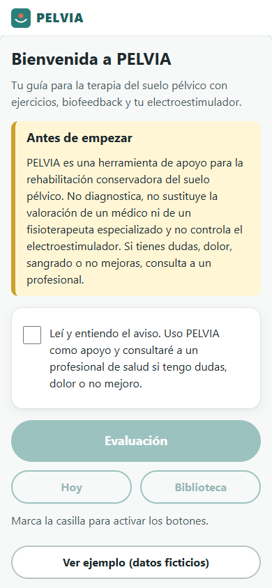

## 2. Evaluación de seguridad
Es el primer paso de la evaluación. Responde **sí** o **no** a todas las preguntas (embarazo, marcapasos, infección, sangrado, etc.).
- Si alguna respuesta hace que la electroestimulación **no sea segura**, verás *"Consulta con tu profesional antes de usar el
  electroestimulador"*. Tu plan tendrá solo ejercicios y hábitos.
- Si aparece una **bandera roja** (por ejemplo, sangre en la orina), verás *"Bandera roja: consulta médica antes de continuar"*.
  La app te propondrá solo ejercicios suaves sin equipo. Cuando ya hayas consultado, toca **Ya consulté con un médico**.
- Las **precauciones** (por ejemplo, DIU o epilepsia) no bloquean, pero muestran un consejo que verás también antes de cada sesión.
- Cada **90 días** la app te pedirá responder de nuevo estas preguntas antes de usar el equipo.

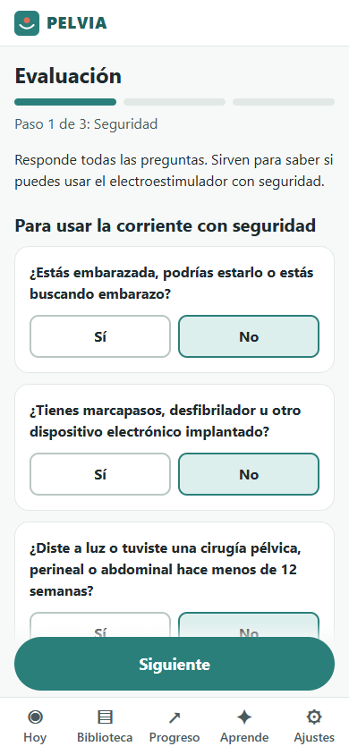

## 3. Cuestionario de síntomas y resultado
1. Para cada pregunta elige cuántas veces te pasa: *Nunca*, *A veces*, *Frecuente* o *Casi siempre*.
2. Responde las 3 preguntas sobre escapes de orina (cuestionario ICIQ). La app calcula tu puntaje de 0 a 21.
3. Al terminar la evaluación, la pantalla **Resultado** te dice tu **perfil** (por ejemplo, *Incontinencia de esfuerzo*), qué tan
   intensos son los síntomas, tu **nivel** y cómo es tu semana tipo. Si conviene que te vea un profesional, lo verás destacado.

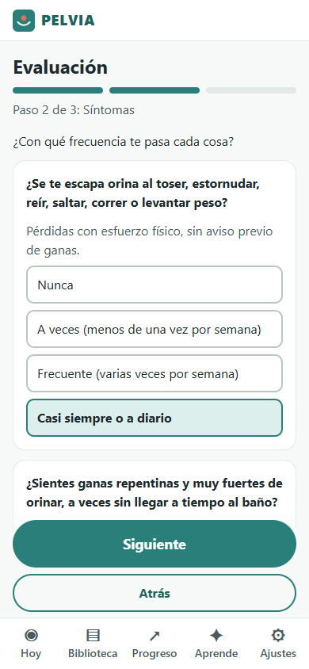 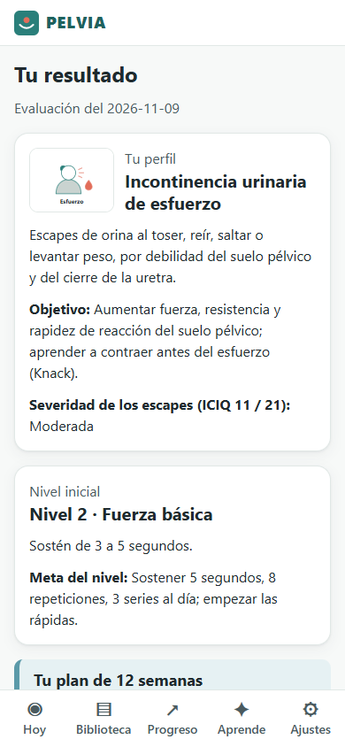

## 4. Autoevaluación de fuerza
Acostada boca arriba con las rodillas dobladas (ilustración IL-03). Haz 3 pruebas cortas:
- **Fuerza (P):** elige la frase que mejor describe lo que sientes al apretar.
- **Resistencia (E):** aprieta lo más fuerte que puedas y cuenta cuántos segundos mantienes (el cronómetro te ayuda). Máximo 10.
- **Repeticiones (R)** y **Rápidas (F):** cuántas logras con la misma fuerza.
Con eso la app elige tu nivel inicial (0 a 4). Si dudas, elige el valor más bajo: es mejor empezar suave.

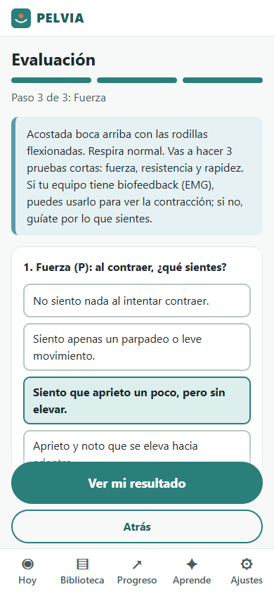

## 5. Tu plan
Tu plan dura **12 semanas**. Cada día tiene sus sesiones: ejercicios, biofeedback, electroestimulación, relajación o hábitos, según tu
perfil y tu nivel. Si alguna sesión se cambió por otra (por ejemplo, porque tu equipo no tiene biofeedback), verás *"en lugar de…"*.
El plan se recalcula solo cuando cambias de nivel, cuando cambias tu equipo o cuando marcas que ya consultaste por una bandera roja.

## 6. Ficha de parámetros
Antes de una sesión con el equipo verás la **ficha**: frecuencia (Hz), ancho de pulso (µs), segundos de trabajo y descanso (ON/OFF),
rampa, minutos e intensidad. Configura tu equipo con esos valores **o** usa el programa que dice *"En tu equipo: programa…"*.
La intensidad (mA) la eliges tú: sube poco a poco hasta sentir una contracción clara, **nunca dolor**.
Si tu equipo fija sus propios valores (por ejemplo, unos shorts), la ficha dice *"Tu equipo fija sus parámetros: solo sigue el temporizador"*.

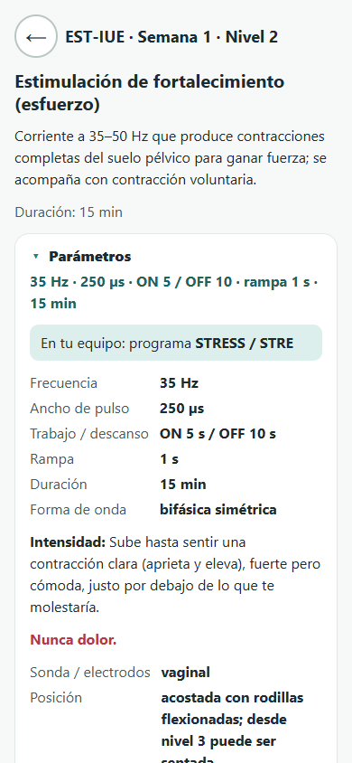

## 7. Sesión guiada con el equipo
1. En **Hoy** toca la sesión (por ejemplo, *Estimulación de fortalecimiento*).
2. Lee la **lista de verificación** (sin infección, sin dolor, sonda limpia con gel, intensidad en 0…) y marca todas las casillas.
   El botón **Confirmo** se activa solo cuando todo está marcado.
3. Revisa la ficha, configura el equipo, coloca la sonda (ilustración IL-07) y toca **Equipo configurado, empezar**.
4. Sigue la pantalla: **CONTRAE** (aprieta y eleva junto con el equipo) y **RELAJA** (suelta del todo). El celular vibra y suena en cada
   cambio; puedes apagarlos en Ajustes. La pantalla se queda encendida.
5. Puedes tocar **Pausa** cuando quieras. **Terminar** te pide confirmación.
6. Al final anota la intensidad que usaste (mA), cuánto esfuerzo sentiste (1 a 10) y si hubo dolor. Toca **Guardar**.
Si en algún momento sientes dolor, ardor o sangrado: baja la intensidad o detén la sesión.

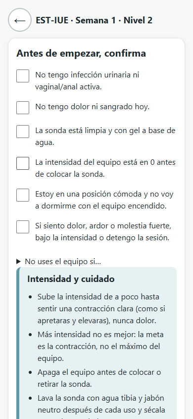 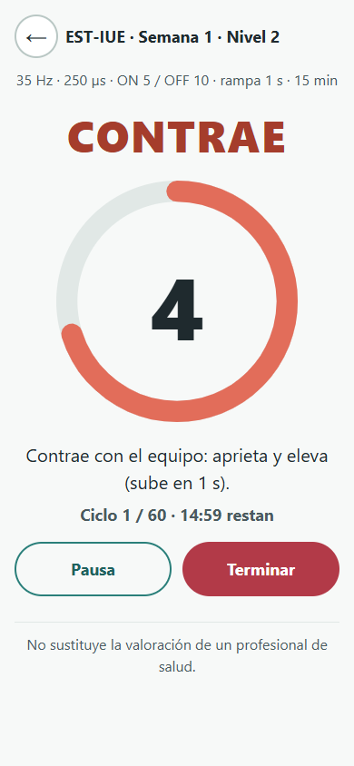 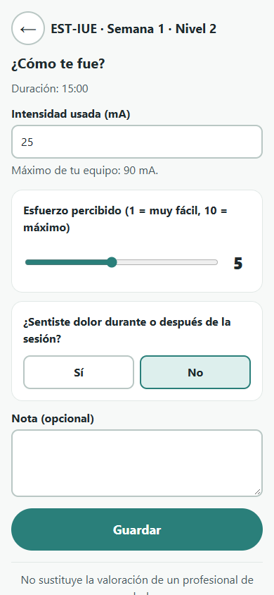

## 8. Ejercicios y biofeedback
Las sesiones de ejercicios funcionan igual que la sesión con equipo, pero sin checklist: la pantalla te guía con contracciones
**lentas** (aprieta y mantén) y **rápidas**, con descansos entre series. Mantén glúteos, muslos y abdomen relajados y no aguantes la
respiración (ilustración IL-02). Si tu equipo tiene **biofeedback (EMG)**, al final puedes anotar el valor máximo y de reposo en µV
que te mostró, y cuántas repeticiones lograste.

## 9. Biblioteca
En **Biblioteca** están **todas** las sesiones y **todos** los niveles, con ilustración, para qué sirven, parámetros, pasos y fuentes.
Las que no convienen para tu perfil dicen *"No recomendada para tu perfil"* y el motivo. Con **Practicar ahora** puedes hacer una sesión
fuera del plan (las de equipo pasan por las mismas comprobaciones de seguridad).

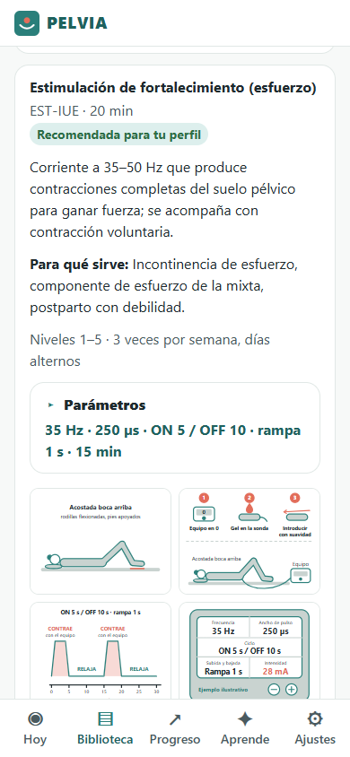

## 10. Cómo subes de nivel
Al empezar cada semana nueva, la app revisa la anterior:
- **Subes** si llevas al menos 2 semanas en el nivel, cumpliste al menos el 70 % del plan, alcanzaste las metas de sostén y rápidas
  en tus 2 últimas autoevaluaciones y no tuviste dolor en las 3 últimas sesiones.
- **Bajas** un nivel si registraste dolor en 2 sesiones seguidas o si en 3 sesiones lograste menos de la mitad de las repeticiones.
- Si no, **sigues** en tu nivel. Siempre verás el motivo.

## 11. Pantalla Hoy
Muestra la semana y tu nivel, las sesiones del día con su estado (**pendiente** o **hecha**), la próxima re-evaluación, tu racha
semanal y los avisos importantes (cambio de nivel, respaldo pendiente, cuestionario de seguridad vencido).

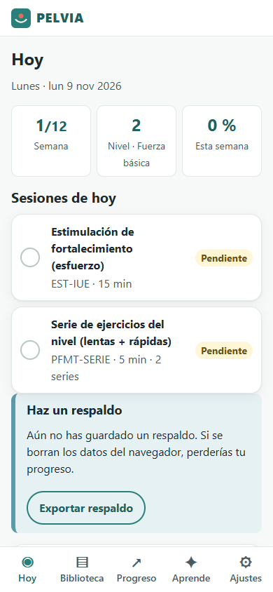

## 12. Progreso
En **Progreso** ves cuánto cumpliste cada semana y cómo cambian tu sostén (E), tus rápidas (F), la intensidad usada (mA) y tu puntaje
de síntomas (ICIQ) con sus fechas. Debajo está el historial de cambios de nivel.

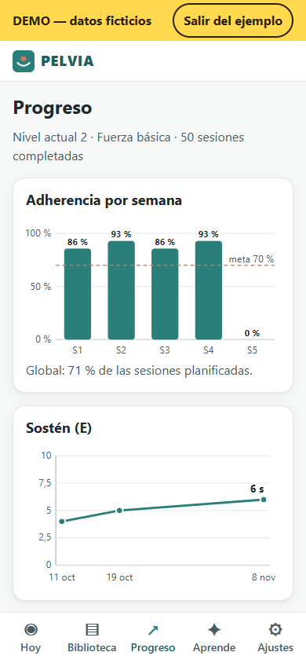

## 13. Re-evaluaciones
El plan te pide repetir la **autoevaluación de fuerza** cada 2 semanas (el lunes) y el **cuestionario de síntomas** en las semanas 4, 8 y
12 (el domingo). Aparecen en **Hoy** como una sesión más. A las 12 semanas, si tu puntaje de síntomas no bajó al menos 2 puntos, verás
*"Mejora insuficiente: te recomendamos valoración por un profesional de suelo pélvico"*. Si mejoraste, pasas al plan de **mantenimiento**.

## 14. Entrenamiento vesical
Para urgencia o incontinencia mixta. En **Ajustes → Entrenamiento vesical** (o desde **Hoy**):
1. Durante 3 días toca **Acabo de orinar** cada vez que vayas al baño, y **Tuve urgencia** o **Tuve un escape** cuando pase.
2. La app calcula tu intervalo medio y te da un **intervalo objetivo** que sube 15 minutos cada semana, hasta 3–4 horas.
3. Si te llega la urgencia antes de la hora: detente, haz 5 contracciones rápidas o una larga de 10 segundos, respira lento, piensa en
   otra cosa y, cuando baje, camina tranquila al baño (sesión *Técnica de supresión*). Ilustración IL-14.

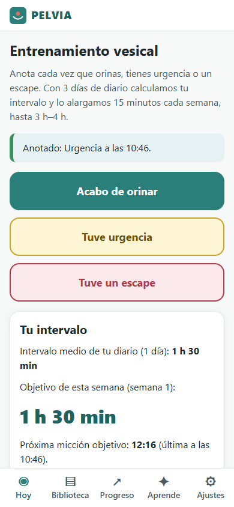

## 15. Ver ejemplo
**Ver ejemplo** carga a *Ana (ejemplo)*, una usuaria ficticia con 4 semanas de datos, para que veas cómo se ve todo. Arriba aparece una
banda amarilla **DEMO — datos ficticios** en todas las pantallas. Para quitarlo toca **Salir del ejemplo** o **Ajustes → Restablecer**.
Ojo: el ejemplo reemplaza tus datos; si ya empezaste tu plan, exporta un respaldo antes.

## 16. Mi equipo
En **Ajustes → Mi equipo**:
1. Elige la **marca** y el **modelo** de tu equipo. Si no lo conoces, elige *Genérico EMS/TENS digital con sonda*.
2. Marca qué sondas o electrodos tienes, si tu equipo **electroestimula** y si tiene **biofeedback (EMG)**, y su intensidad máxima.
3. Revisa la tabla de **programas**: nombre del programa en tu equipo → sesión de PELVIA. Puedes corregirla con tu manual.
4. Toca **Guardar mi equipo**. Tu plan se recalcula: por ejemplo, si tu equipo no tiene EMG, el biofeedback se cambia por ejercicios.

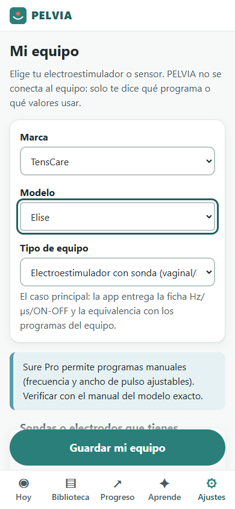

## 17. Respaldo e informe
- **Exportar respaldo** (Ajustes) descarga un archivo `pelvia-respaldo-AAAA-MM-DD.json` con todos tus datos. Guárdalo en un lugar
  seguro (es información de salud). Hazlo al menos una vez al mes: la app te lo recuerda.
- **Importar** recupera un respaldo (por ejemplo, en un celular nuevo). Reemplaza lo que haya.
- **Informe para mi profesional** abre una página para imprimir o guardar como PDF con tus evaluaciones, nivel, cumplimiento y gráficas.

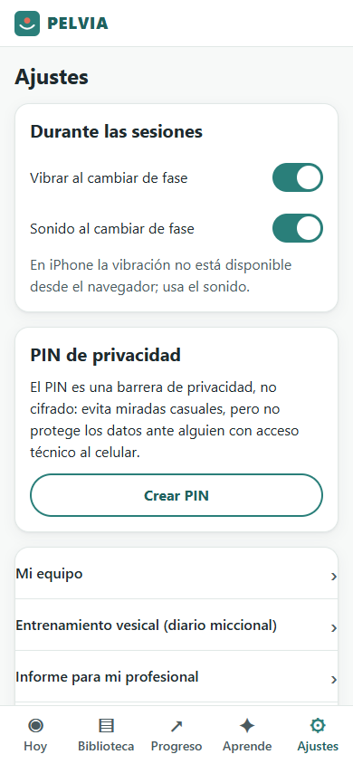 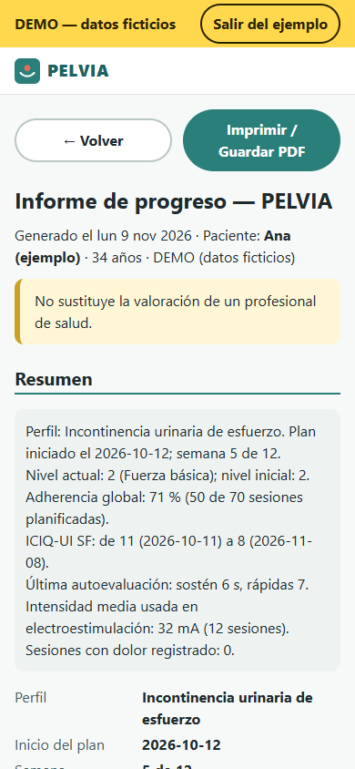

## 18. PIN
En **Ajustes → PIN** puedes poner un código de 4 números que se pide al abrir la app. Es una barrera para miradas curiosas, no un
cifrado. Si lo olvidas, después de 5 intentos la única salida es **Restablecer datos** (se borra todo; por eso conviene tener respaldo).

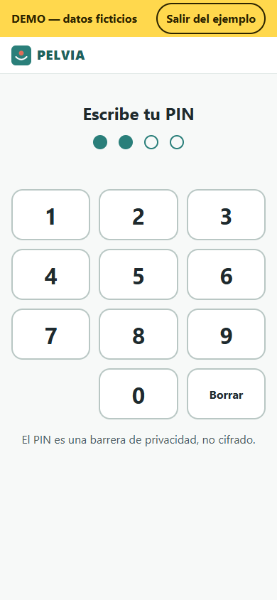

## 19. Aprende
En **Aprende** hay explicaciones cortas con ilustraciones: qué es el suelo pélvico (IL-01), **cómo contraer correctamente** y los
errores comunes (IL-02), lentas y rápidas, el *Knack* (IL-10), cómo funciona la electroestimulación (IL-12), el biofeedback, hábitos,
cuidado de la sonda (IL-07) y cuándo consultar.

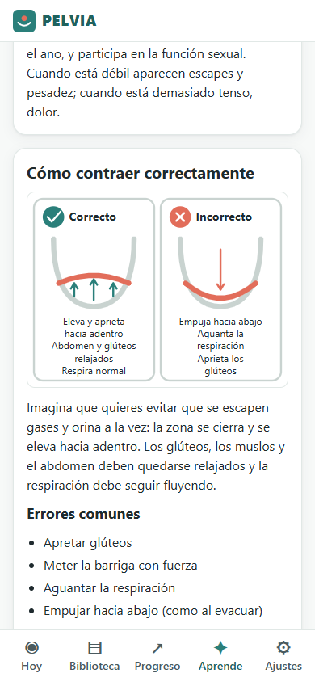

---

## Problemas frecuentes
| Me pasa… | Por qué | Qué hacer |
|---|---|---|
| **No vibra en mi iPhone** | Safari en iPhone no permite que las páginas web vibren. Es normal. | Deja el **sonido** activado en Ajustes y el volumen alto. |
| **No suena** | El celular está en silencio o el volumen multimedia está bajo. | Sube el volumen; en Ajustes revisa que *Sonido* esté activo. Toca la pantalla una vez al empezar. |
| **Se apaga la pantalla durante la sesión** | Tu navegador no permitió mantenerla encendida (ahorro de batería). | Desactiva el ahorro de batería durante la sesión o sube el tiempo de apagado de pantalla en la configuración del celular. Si se apagó, al volver la sesión sigue en el punto correcto. |
| **Perdí mis datos** (cambié de celular o borré el navegador) | Los datos viven solo en ese navegador. | **Ajustes → Importar** tu último respaldo `pelvia-respaldo-….json`. |
| **No puedo iniciar la sesión con el equipo** | Hay una contraindicación, una bandera roja sin consultar o el cuestionario tiene más de 90 días. | Lee el motivo en pantalla; responde de nuevo el cuestionario de seguridad o consulta con tu profesional. |
| **Dice "Nueva versión disponible — recargar"** | Se publicó una mejora. | Toca el aviso; tus datos se mantienen. |
| **Olvidé el PIN** | — | Tras 5 intentos aparece **Restablecer datos**. Luego importa tu respaldo. |
